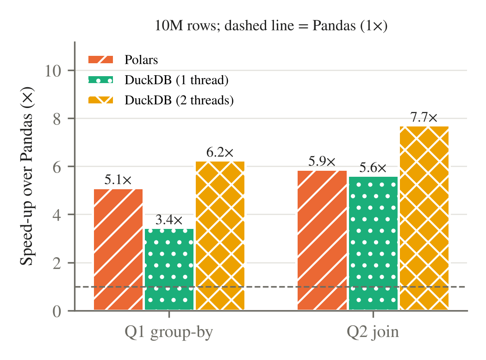

# G14 · Hardware-Accelerated Query Processing

Code, data generator and results for the paper:

> **Vectorised Execution versus Multi-Core Parallelism: Benchmarking Pandas, Polars and DuckDB on Group-By and Join Queries**
> Krish, Krish Singhal, Laksh Kapoor, Lucky. Dept. of Information Technology, Dr B R Ambedkar NIT Jalandhar, 2026.

We time two common analytical queries in **Pandas**, **Polars** and **DuckDB** on 1M, 5M and 10M rows.
DuckDB is run **twice**, on 1 thread and on all threads. That separates two causes of the speed-up:
how the engine executes the query (vectorised, columnar, SIMD-friendly) and how many CPU cores it uses.

## Key result (10M rows, 2-core CPU)

| Engine | Q1 group-by | Q2 join | Speed-up over Pandas |
|---|---:|---:|---:|
| Pandas | 238.1 ms | 1568.0 ms | 1× |
| Polars | 46.6 ms | 267.0 ms | 5.1× / 5.9× |
| DuckDB, 1 thread | 69.2 ms | 279.4 ms | **3.4× / 5.6×** |
| DuckDB, 2 threads | 38.1 ms | 203.5 ms | 6.2× / 7.7× |

**Even on a single core, DuckDB is 3.4–5.6× faster than Pandas.** A second core adds only 1.4–1.8× more.
On ordinary hardware, most of the gain comes from the *execution model*, not from parallelism.
All engines return identical answers, and the benchmark checks this automatically.



## Quick start

Requires Python 3.10+ (results were produced with 3.13) and about 1 GB of free RAM.

```bash
git clone https://github.com/LakshK001/g14-hardware-accelerated-query.git
cd g14-hardware-accelerated-query
python -m venv .venv
# Windows: .venv\Scripts\activate      macOS/Linux: source .venv/bin/activate
pip install -r requirements.txt

python run_all.py --quick   # 1-minute smoke test (1M rows, 3 runs)
python run_all.py           # full experiment, about 3-5 minutes
```

`run_all.py` generates the data, runs every query, checks that all engines agree, and redraws the figures.
Your times will differ from ours: a laptop with more cores will show a bigger multi-thread gain.
The single-thread speed-up should stay similar.

## Queries

```sql
-- Q1: group-by (100 groups)
SELECT store_id, SUM(amount), AVG(quantity), COUNT(*) FROM orders GROUP BY store_id;

-- Q2: join + group-by (5 groups)
SELECT c.segment, SUM(o.amount), COUNT(*)
FROM orders o JOIN customers c ON o.customer_id = c.customer_id
GROUP BY c.segment;
```

Pandas and Polars run the same logic in their own APIs (see `src/benchmark.py`).

## Method

- **Data:** synthetic `orders` (N rows) and `customers` (N/10 rows), fixed seed 42, stored as Parquet. No personal or real data is used.
- **Timing:** tables are loaded into memory first, so only query execution is timed. Each query gets 1 warm-up run plus 10 timed runs, and we report the median (min and max are kept in the CSV).
- **Correctness:** each engine's result is compared with Pandas (same row count, sums within 1e-6 relative tolerance, identical counts).
- **Decomposition:** Pandas ÷ DuckDB(1 thread) = execution-model gain; DuckDB(1) ÷ DuckDB(all) = thread gain.

## Repository layout

```
├── run_all.py              # one command to reproduce everything
├── requirements.txt        # pinned library versions
├── src/
│   ├── generate_data.py    # synthetic orders/customers → Parquet
│   ├── benchmark.py        # Q1/Q2 on Pandas, Polars, DuckDB (1 & all threads)
│   └── make_figures.py     # figures + summary table
├── results/
│   ├── results.csv         # all timings (median/min/max, 3 sizes × 4 engines × 2 queries)
│   ├── summary_largest.csv # speed-ups at 10M rows
│   └── environment.json    # library versions and CPU of the run
└── figures/                # fig1_query_time, fig2_scaling, fig3_speedup (PNG + PDF)
```

## Test environment

Cloud VM: Intel Xeon @ 2.10 GHz, 2 vCPUs (AVX2/AVX-512), 7 GB RAM, no GPU, Linux.
Python 3.13.18, Pandas 3.0.5, Polars 2.1.0, DuckDB 2.0.1, PyArrow 26.0.1.

## Limitations

- Only 2 CPU cores, so the multi-thread gain is a lower bound.
- No GPU, so cuDF was not measured. It can be added on a free Google Colab GPU in future work.
- Keys are uniformly distributed. Real data is often skewed.
- Only in-memory execution is timed; file loading is excluded.

## License

MIT. See [LICENSE](LICENSE).
